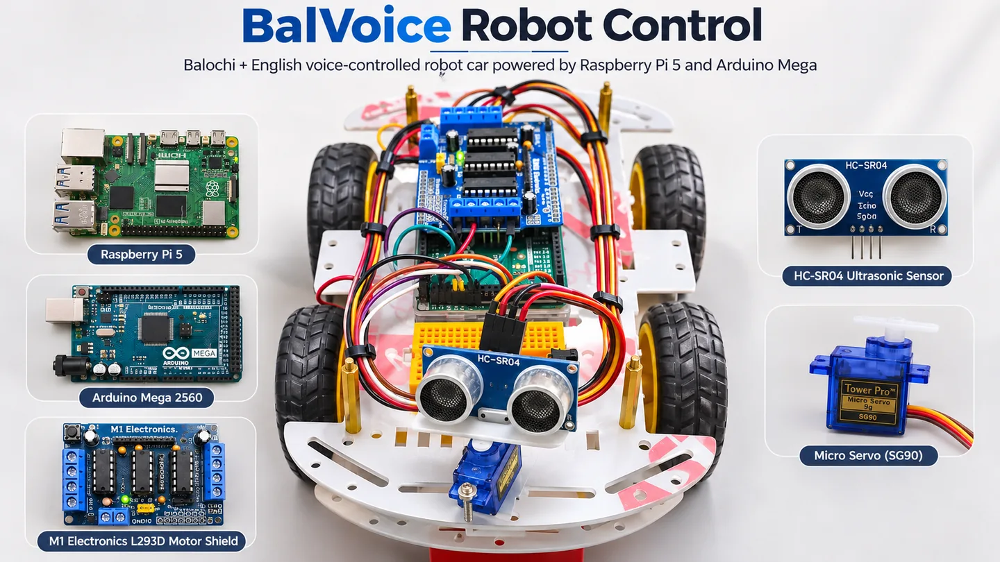
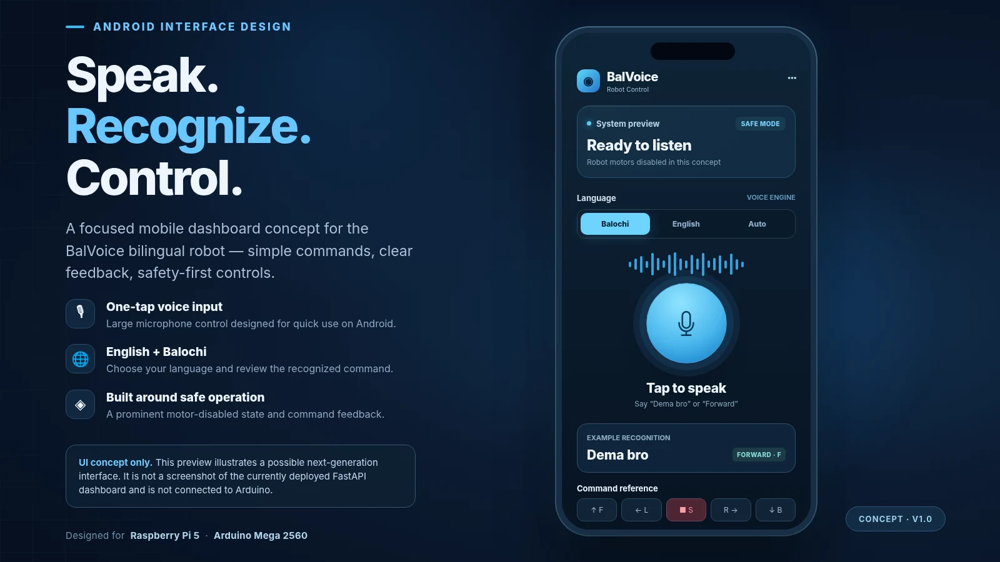
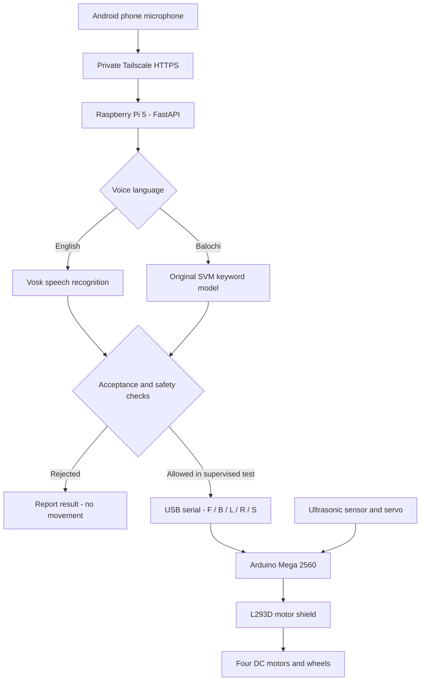

<div align="center">

# BalVoice Robot Control

**A Balochi + English voice-controlled four-wheel robot**  
*Raspberry Pi 5 · Arduino Mega 2560 · Offline Speech Recognition · Android Browser*



[](docs/SAFETY.md)
[](docs/ARCHITECTURE.md)
[](Arduino/Robot_Car_Bilingual_Safe/Robot_Car_Bilingual_Safe.ino)
[](#voice-commands)
[](#speech-recognition-models)

**[Quick Start](#quick-start--raspberry-pi)** · **[Voice Commands](#voice-commands)** · **[Hardware](#hardware--connections)** · **[Models](#speech-recognition-models)** · **[Safety](#safety-first)** · **[Troubleshooting](docs/TROUBLESHOOTING.md)**

</div>

> [!IMPORTANT]
> **Experimental robotics project, not a validated autonomous vehicle.** The Balochi classifiers have substantial errors on unseen recordings. Motor power is disabled by default in the Pi app. Use an accessible physical motor-power cutoff, lift the wheels during initial tests, and do not use unreliable speech recognition for unattended movement.

## Meet BalVoice

**BalVoice** is a university robotics research prototype that explores voice interaction in **Balochi and English**. An Android phone records a short spoken instruction; a Raspberry Pi 5 processes the sound and, when checks permit it, sends a one-letter serial command to an Arduino Mega 2560. The Arduino contains motor-control and ultrasonic obstacle-handling code.

The project aims to make human–robot interaction accessible in a local language using lightweight speech models and inexpensive robot hardware. It is an **evolving prototype**, with both working software components and unresolved hardware/reliability tests.

### Mobile control dashboard — design concept



> **Design preview, not a live application screenshot.** This mockup illustrates a possible next-generation phone dashboard. Its example recognition result and command reference are nonfunctional. The actual browser voice interface used by the current FastAPI application is [`index.html`](index.html). You can inspect the standalone [mobile design preview](design/mobile-dashboard-concept.html); it does **not** control hardware.

The **robot hero illustration** above is a rendered showcase based on project component and assembly photographs, not a substitute for measured real-world validation.

## Highlights

| Capability | How it works | Current status |
|---|---|---|
| English voice commands | Offline **Vosk** recognizer | Integrated in voice server; requires external English Vosk checkpoint |
| Balochi commands | Original **MFCC + SVM** keyword recognizer | Integrated but weak on new phone recordings |
| Two experimental Balochi models | MFCC SVM + log-mel CNN comparison | Trained and evaluated for recognition-only testing |
| Android microphone | Browser recording over private Tailscale HTTPS | Implemented; requires running Pi service and private network |
| Arduino communication | USB serial with firmware handshake and guarded command sending | Implemented; USB stability and powered motor operation still need verification |
| Four-wheel drive | Arduino Mega + AFMotor V1 L293D motor shield | Firmware implemented; actual movement not fully validated end-to-end |
| Obstacle sensing | Ultrasonic distance sensor + servo sweep | Firmware implemented; supervised physical testing required |
| Safety checks | Confidence rejection, disabled-by-default motors, short movement pulses | Implemented in code; **not** a certified safety system |

## How it works



The **research CNN is not connected to the moving robot** by default. The Arduino's `A` autonomous-mode command is a separate manual mode, not a voice command automatically sent by the Pi.

## Voice commands

| Action | English | Balochi (Latin script) | Arduino code |
|:---|:---|:---|:---:|
| Stop | Stop / Halt | **Bosht** | `S` |
| Forward | Forward | **Dema bro** | `F` |
| Reverse | Backward | **Poshta bro** | `B` |
| Left | Left / Turn left | **Chapen kasha bro** | `L` |
| Right | Right / Turn right | **Rasten kash a bro** | `R` |

**Arduino-only diagnostics:** `?` requests `PONG_SAFE_V06`, `D` asks for `DISTANCE_CM`, `V` selects stopped voice mode, and `A` selects the separate automatic obstacle-avoidance mode. A recognized command can still be rejected because of low confidence, unavailable Arduino connection, or a failed safety check.

## Hardware & connections

| Component | Role |
|---|---|
| Raspberry Pi 5, appropriate power supply | FastAPI backend, audio processing, private networking |
| Arduino Mega 2560 | Serial receiver, motor timing, ultrasonic/servo control |
| L293D **AFMotor V1** motor shield | M1–M4 outputs for four DC gear motors |
| Four-wheel chassis | Vehicle platform |
| Ultrasonic sensor | Distance measurement; sketch `TRIG=24`, `ECHO=22` |
| Micro servo | Sweeps the sensor; sketch `SERVO=44` |
| Separate, properly rated motor power + accessible cutoff | Motor electricity independent of Raspberry Pi USB power |
| Android phone with Chrome | Capture and send voice command clips |
| Private Tailscale network | HTTPS communication between phone and Pi |

**Electrical warning:** verify the exact motor shield revision and its supply jumper before attaching the motor battery. Disconnect every power source before rewiring. **Never power the motors from the Pi USB port or connect raw motor-battery power to Raspberry Pi GPIO.**

## Quick start — Raspberry Pi

### 1. Install the application (motors remain off)

```bash
sudo apt update
sudo apt install -y python3-venv ffmpeg libsndfile1

git clone https://github.com/shah-bakhsh/BalVoice-Robot-Control.git
cd BalVoice-Robot-Control
python3 -m venv .venv
source .venv/bin/activate
python -m pip install -r requirements.txt
```

### 2. Configure the external English Vosk model

Download the licensed `vosk-model-small-en-us-0.15` model separately and update the local path:

```bash
export VOSK_MODEL_PATH="$HOME/robot-live-voice/models/vosk-model-small-en-us-0.15"
python check_install.py
```

### 3. Start the recognition-only server

```bash
bash start_robot.sh
```

The default server uses **`127.0.0.1:8001`** and **does not enable motors**. Keep it running; in a second terminal, inspect the status endpoint:

```bash
curl -sS -i http://127.0.0.1:8001/status
```

### 4. Access it privately from Android

Check your existing Tailscale settings on the Pi:

```bash
tailscale status
tailscale serve status
```

If necessary, configure a private Tailscale Serve HTTPS proxy for port `8001` according to your installed Tailscale version. On the phone, enable Tailscale, open the **private HTTPS address** in Chrome, allow microphone permission, and test one short instruction. Never expose the motor-control page publicly.

> The included `design/mobile-dashboard-concept.html` is only a static layout. For real recording and recognition, use the **FastAPI-served home page** from `index.html`.

## Arduino firmware and independent hardware checks

1. Open [`Arduino/Robot_Car_Bilingual_Safe/Robot_Car_Bilingual_Safe.ino`](Arduino/Robot_Car_Bilingual_Safe/Robot_Car_Bilingual_Safe.ino) in Arduino IDE. Select **Arduino Mega 2560** and install the compatible **AFMotor V1** library.
2. With **motor battery disconnected**, ensure no other program holds the serial port (stop the Pi voice server and Arduino Serial Monitor).
3. Check the firmware handshake and ultrasonic measurement:

```bash
source .venv/bin/activate
python test_arduino.py '?'
python test_arduino.py D
```

Expected response to `?`: `PONG_SAFE_V06`. The distance query should return `DISTANCE_CM`. Do not continue to powered tests if USB disconnects, the Arduino fails the handshake, or distance sensing is unreliable. See [hardware troubleshooting](docs/TROUBLESHOOTING.md) and [safety rules](docs/SAFETY.md).

## Speech recognition models

BalVoice separates its **currently integrated original Balochi SVM** from two newer **recognition-only candidates**:

| Model | Feature representation | Reported shuffled 3-fold CV | Deployed as motor controller? |
|---|---|---:|---|
| Original integrated Balochi SVM | MFCC-style features | Experimental; phone command scores sometimes ~0.30 | In voice server, but confidence-gated |
| Research SVM | MFCC temporal features | **69.0%** (156 / 226) | No |
| Research CNN | Log-mel spectrogram | **72.1%** (163 / 226) | No |

The research set contained **229 recordings**, reduced to **226 unique clips** after removing three exact duplicates. The CNN misclassified **12 of 25 noise recordings** in the reported cross-validation. These numbers **do not establish accuracy on new speakers or actual robot safety**; recording-source effects were substantial.

Read [`research_dual_models/README.md`](research_dual_models/README.md) and [`research_dual_models/evaluation.json`](research_dual_models/evaluation.json) for details.

### Compare the research models without moving motors

```bash
cd research_dual_models
python3 -m venv .venv
source .venv/bin/activate
python -m pip install -r requirements_pi.txt
python test_dual.py /path/to/recording.wav --mode balochi
```

No automatic command transmission to Arduino is performed by the research comparison app.

## Repository guide

```text
BalVoice-Robot-Control/
├── README.md
├── assets/
│   ├── balvoice-robot-showcase.webp       # Rendered project illustration
│   └── balvoice-mobile-dashboard.webp    # Proposed mobile UI preview
├── design/
│   └── mobile-dashboard-concept.html      # Static UI preview, no Arduino connection
├── app.py, index.html                     # Current FastAPI voice application
├── recognizer.py                          # Vosk and original Balochi SVM routing
├── motor_link.py, test_arduino.py         # Guarded USB serial and test tools
├── balochi_model_v02.joblib              # Integrated original classifier
├── Arduino/Robot_Car_Bilingual_Safe/     # Arduino Mega firmware
├── research_dual_models/                 # CNN/SVM checkpoints, training, evaluation
├── docs/                                 # Architecture, safety, troubleshooting
├── tests/                                # Integrity checks
├── start_robot.sh, requirements.txt
└── MODEL_SHA256SUMS                       # Model checksums
```

## Safety first

- **Motor control is disabled by default**; do not bypass failed checks or lower speech confidence thresholds to force motion.
- Use an accessible **physical cutoff** and elevate the wheels for early testing.
- Check USB stability and separate motor power before hardware experiments.
- Never treat a voice classifier score as a certified safety guarantee.
- Do not operate the robot unattended or near people until independent sensing and emergency-stop reliability have been verified.
- Do not publish speakers' voice recordings without appropriate consent.

See [`docs/SAFETY.md`](docs/SAFETY.md).

## Testing, known limitations and next steps

```bash
python3 -m compileall -q app.py recognizer.py motor_link.py research_dual_models
python3 -m unittest discover -s tests -v
sha256sum -c MODEL_SHA256SUMS
```

These checks verify syntax and model-file integrity; they do **not** establish physical motor operation, recognition reliability, or mechanical safety.

**Current gaps:** Balochi new-speaker robustness, reliable rejection of noise, independent phone-session and USB stability testing, verified powered movement from the integrated app, and independently tested emergency-stop behavior. Future work includes collecting more varied phone data, better evaluation, safely integrating a stronger model, and improving the mobile UI.

## Team and academic context

A Computer Science robotics project at the **University of Turbat**. Project group: **Shah Bakhsh, Baber Sakhee, Nizam Ud Din, and Faisal Ghulam**.

## Links and further reading

- [Repository source](https://github.com/shah-bakhsh/BalVoice-Robot-Control)
- [Hugging Face model repository](https://huggingface.co/shah-bakhsh/BalVoice-Robot-Control) — verify checkpoint availability separately
- [Architecture](docs/ARCHITECTURE.md) · [Safety](docs/SAFETY.md) · [Troubleshooting](docs/TROUBLESHOOTING.md)
- [Historical integration instructions](docs/VOICE_SERVER_V06.md)
- [Model checksums](MODEL_SHA256SUMS)

---

<div align="center">

**BalVoice Robot Control** · Balochi-language AI research, embedded systems, and responsible robotics.

*No open-source license is currently granted by the repository. Third-party software and model licenses apply separately.*

</div>